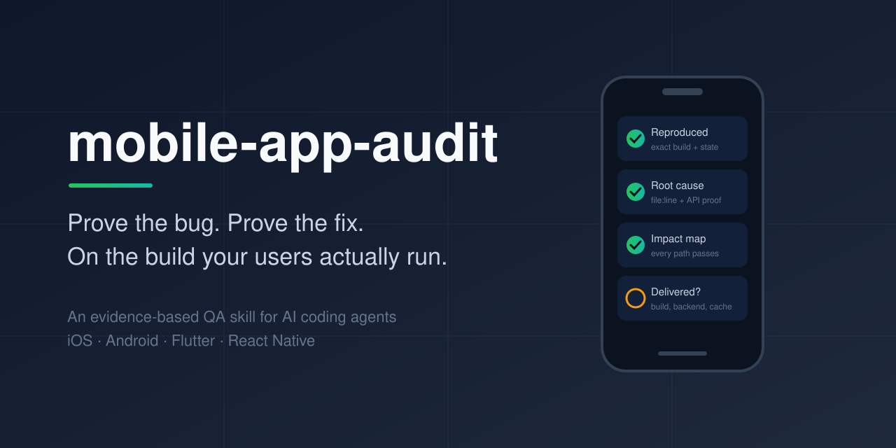
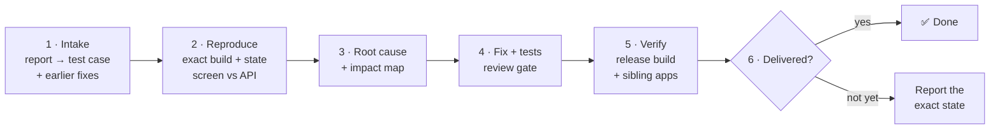

<p align="center">
  
</p>

<p align="center">
  <a href="CHANGELOG.md"></a>
  <a href="LICENSE"></a>
  
  <a href="#-compatibility"></a>
  <a href="evals/results/2.2.0/claude-code/summary.md"></a>
  <a href="evals/results/2.4.0/claude-code/summary.md"></a>
  <a href="evals/results/2.5.0/claude-code/triggers.md"></a>
  <a href="https://github.com/ronaldmaco/mobile-app-audit/actions/workflows/anonymised.yml"></a>
</p>

<p align="center">
  <b>An evidence-based QA skill for AI coding agents.</b> It follows the open Agent Skills format and is validated on Claude Code; see the <a href="#-compatibility">Compatibility table</a> for other agents.<br>
  It does not stop at "it seems to work": a finding is <b>Verified</b> when it is proven (reproduced, shown by a request, or traced to a concrete code trigger) and <b>Suspected</b> otherwise, and every fix is checked on the build your users actually run.
</p>

<p align="center">
  <a href="#-quick-start">Quick start</a> ·
  <a href="#-how-it-works">How it works</a> ·
  <a href="#-what-you-get">Example report</a> ·
  <a href="#-real-cases">Real cases</a> ·
  <a href="#-roadmap">Roadmap</a>
</p>

---

## 🤔 The problem

> *"We fixed that last week. Why are users still sending videos of it?"*

Usually the code is only part of the problem. The user is on an old build. The backend was never deployed. A CDN serves a cached response. The fix landed on iOS but not Android. Or the fix hid the user's input, so the bug now shows up somewhere else.

Device tools such as mobile-mcp let an agent see and tap the phone. **This skill adds the judgement of a QA specialist:** what to check, how to prove it, and when a bug is really done.

## ✨ What makes it different

| | Typical AI review | mobile-app-audit |
|---|---|---|
| Findings | "This might cause an issue" | Each finding is **Verified** (reproduced, proven by a request, or traced to a concrete code trigger) or **Suspected** |
| Fixes | Patch the reported case | Build an **impact map** (inputs × screens × states × data) and require every cell to pass |
| Backend | Assumed correct | A **ground-truth oracle** compares the screen with the API for the same parameters |
| "Done" | Code merged | **Delivered**: the fix is in the build, backend, cache and OTA channel that users actually get |
| Design | May "improve" the UI | **Keeps the design.** Only loading, error and retry states are added |

## 🚀 Quick start

**Claude Code (recommended)**
```
/plugin marketplace add ronaldmaco/mobile-app-audit
/plugin install mobile-app-audit@mobile-app-audit
```
Update later with `/plugin marketplace update mobile-app-audit`.

<details>
<summary><b>Other ways to install</b></summary>

**Claude Code, manual copy.** Copy `skills/mobile-app-audit/` into `~/.claude/skills/` (all projects) or `.claude/skills/` (one project). Keep only **one** installed copy: a manual copy and the plugin share a name, and an outdated copy can load instead of the latest one.

**Claude.ai / Claude desktop.** Zip the folder `skills/mobile-app-audit/` (the one that contains `SKILL.md`) and upload it in **Settings → Capabilities → Skills**.

**Codex, Cursor, Gemini CLI, GitHub Copilot, OpenCode and other agents.** The skill follows the open [Agent Skills](https://agentskills.io) format. One command installs it in `~/.agents/skills`, a folder that Codex, Cursor and OpenCode all read:
```bash
git clone https://github.com/ronaldmaco/mobile-app-audit.git && mobile-app-audit/scripts/install.sh
```
Folders for every agent, project installs and what the skill needs from the agent: [docs/INSTALL.md](docs/INSTALL.md).
</details>

Then just ask:

- *"A user sent this video: saving the profile fails. Verify the bug and fix it."*
- *"We fixed this last week but users still see it. Find out why."*
- *"Audit the login and checkout flows."*
- *"Get the app ready for App Store review."*

## 🔍 How it works

The agent picks the **smallest mode** that answers your question:

| Mode | Use it when |
|---|---|
| **A · Bug verification** | A user reports a bug (with videos or screenshots), or a fix "did not work" |
| **B · Fix verification** | Someone says it is fixed and you want proof before closing |
| **C · Targeted audit** | One area: login, filters, payments, push… |
| **D · Full audit** | Before a release, or on a codebase you just inherited |
| **E · Store readiness** | Before App Store / Google Play submission, or after a rejection |

Every bug goes through the same loop:



It covers code review, device testing under bad conditions (slow or lost network, app killed, other regions, old data), backend and CDN checks, security (OWASP MASVS), performance, accessibility, production crashes and store rules.

## 📄 What you get

A report where you can tell what was proven, what is only suspected, and what could not be tested. Here is one finding from the [full example](examples/bug-verification-report.md):

```
[F1] [High] The venue filter is dropped for venues without events
Status: Verified
Cause: the day-1 fix removed id 0 from the request; with only unlinked venues
       selected the list is empty, and the API reads an empty list as "any venue"
Evidence: oracle row "as the app sends it" = 180 events, same titles as the user's screenshot
Impact map: 8 rows checked, 3 failing, 1 not tested (no old build available)
Delivery: app build 3.4.2 (1); CMS fix by the content team, no build needed
```

## 🧪 Real cases

Every check in the skill comes from a real audit, on iOS and Android. Each case is **anonymised**: the domain, names and numbers are changed, and only the mechanism is kept.

| # | Case | What it taught the skill |
|---|---|---|
| [001](cases/001-dropped-filter-returns-everything.md) | A filter fix made the list ignore the filter | Impact map, ground-truth oracle, "never hide the user's input" |
| [002](cases/002-write-used-as-read.md) | The profile was "read" with an empty PUT | Reads must use read methods |
| [003](cases/003-valid-preferences-empty-home.md) | Valid preferences, empty Home | Combination sweep; the right result for empty data depends on the screen |
| [004](cases/004-sdk-lifecycle-launch-crash.md) | The app did not launch with the new SDK | Launch with the submission toolchain before you submit |
| [005](cases/005-analytics-switch-and-logout-leaks.md) | Analytics off, still tracked; logout kept the user | Consent must reach every SDK; where caches live |
| [006](cases/006-same-crash-in-sibling-apps.md) | The same crash in two sibling apps | Unpaired system events; sibling check |
| [007](cases/007-silent-failures-and-late-images.md) | Endless spinners, 4xx as success, wrong images | Status codes, cell reuse races |
| [008](cases/008-fixes-never-reached-the-other-platform.md) | The iOS fixes never reached Android | A cheap sibling check, platform by platform |
| [009](cases/009-loading-flag-never-reset.md) | A loading flag that never resets | Clear in-flight flags on every outcome |
| [010](cases/010-errors-without-body-and-cache-as-success.md) | Offline errors vanish; failed writes "succeed" from cache | Transport errors and cache fallbacks |
| [011](cases/011-random-getter.md) | The card opens a different item than it shows | Non-deterministic getters, empty `random()` |
| [012](cases/012-shared-enum-mutated.md) | Analytics context leaks between screens | Mutable shared constants |

The cases are also an **[eval set](evals/)**: each one has a prompt, a small fixture, and a list of what the answer must and must not do, so every release can be measured. Run it with and without the skill to see what the skill adds.

**First results (2.2.0, Claude Code, Opus 5.5):** with the skill 8/8 evals pass; without it 5/8. The model is already strong on its own (26 of 29 checks); the skill adds the impact map, the right meaning of empty results per screen, and consent handled end to end. These evals come from the cases that shaped the skill, so they favour it. [Details and limits](evals/results/2.2.0/claude-code/summary.md).

**Android evals (2.4.0):** e009-e013 pass with and without the skill (5/5 each). They are too small to show a difference, so they serve as a regression check; harder Android fixtures are on the roadmap. [Details](evals/results/2.4.0/claude-code/summary.md).

**Trigger eval (2.5.0):** on 14 prompts written together with the new description (1 run each), the skill loaded on 8/8 it should and 0/6 it should not; 2.4.1 loaded on 6/8. Not yet checked on other phrasings or with repeated runs. e014, a harder eval where the fix exists on the other platform, hit the ceiling twice: the model found the fix without the skill, and the skill (2.4.1) never loaded, so the pilots did not test it. Kept as a regression check. [Details](evals/results/2.5.0/claude-code/triggers.md).

## 🔌 Compatibility

| Agent | Install | Status |
|---|---|---|
| Claude Code | plugin or `~/.claude/skills` | ✅ Real audits + [evals](evals/results/2.2.0/claude-code/summary.md) |
| Claude.ai / Claude desktop | skill upload | ✅ |
| OpenCode | `~/.agents/skills` | 🟡 Finds the skill; full eval run not completed yet |
| Gemini CLI | `~/.gemini/skills` | 🟡 Ran one eval; the skill did not activate in that run |
| Codex, Cursor, GitHub Copilot | `~/.agents/skills`, `~/.copilot/skills` | ⚪ Same skill format, not run yet |

The skill only needs file reading and a shell; device tools are optional. See [docs/INSTALL.md](docs/INSTALL.md).

| Stack | Status |
|---|---|
| Native iOS (Swift, UIKit) | ✅ Used in real audits |
| Native Android (Kotlin, legacy Java, XML views) | ✅ Used in real audits (cases 008-012) |
| Flutter, React Native / Expo | ✔️ Covered by the checklist |
| Objective-C, KMP, MAUI, Ionic, wearables, BLE | 🧭 Planned for 2.7 |

## 🧭 Roadmap

- [x] **2.1** Impact map, ground-truth oracle, lighter core with references loaded on demand
- [x] **2.2** Seven anonymised real cases, eval set, example report, anonymisation check in CI
- [x] **2.3 Any agent:** tools described by what they do, installer for any agent, `AGENTS.md`, per-agent install guide and compatibility results
- [x] **2.4 Android:** five real Android cases (Kotlin, legacy Java), Kotlin evals, sibling check method across platforms
- [x] **2.5 Trigger:** the skill loads for reported mobile bugs, trigger eval in `evals/triggers.json`, e014 eval hardened and piloted (ceiling reached; kept as a regression check)
- [ ] **2.6 Flows:** OTP and 2FA, social login and passkeys, magic links, payments and subscriptions, onboarding and permissions, offline sync, uploads, forced update
- [ ] **2.7 More stacks:** Objective-C, Kotlin Multiplatform, .NET MAUI, Ionic/Capacitor, CocoaPods/SPM, watchOS/Wear OS, Bluetooth; harder Android evals
- [ ] **2.8 Wider cases:** apps the maintainer did not build, reviewed with the owner's permission (open-source apps, or under a client agreement); each finding is rewritten as an anonymised case that states its origin
- [ ] A Maestro flow for every verified bug, so the scenario runs in CI
- [ ] Spec conformance, data correctness (calculations, time zones, sync), architecture review

## 🤝 Contributing

Real cases make this auditor sharper. When the skill misses something, open a **[Case report](.github/ISSUE_TEMPLATE/case-report.md)**. Before you share anything from a private app, read the anonymisation rules in [CONTRIBUTING.md](CONTRIBUTING.md#anonymise-everything).

## 👤 Author

Created and maintained by **[Ronald Maco](https://github.com/ronaldmaco)**. The cases, checks and judgement come from his audits of real mobile apps; he decides what goes in and reviews every change. [Claude Code](https://claude.com/claude-code) helps with drafting and automation, so commits it worked on carry a `Co-Authored-By` line.

## 📜 License

[MIT](LICENSE) © 2026 Ronald Maco
